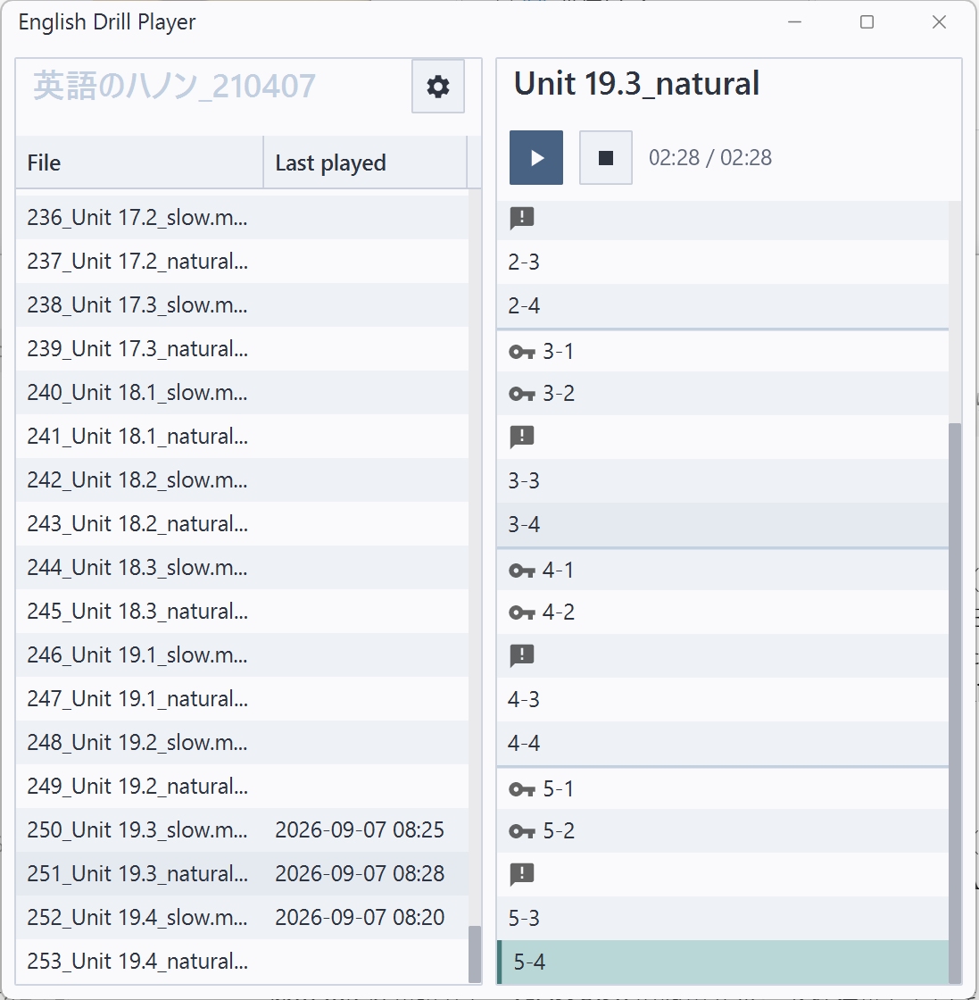

# English Drill Player

This is a practice audio player for "Eigo no Hanon" (English Hanon).

You need to buy "Eigo no Hanon" and download the audio files that come with it.

This player detects silence in the audio and automatically splits the audio into drills.



## Requirements

- Java 25
- Maven

## How to Run

```bash
mvn javafx:run
```

## Development

### JavaFX Preview Features

The main window uses `StageStyle.EXTENDED` and `HeaderBar`, which are preview
features of JavaFX 26. These features require the JVM option `-Djavafx.enablePreview=true`.
The option is already set in `pom.xml` for `mvn javafx:run`, `mvn test`, and
the packaged app (jpackage).

### How to Test

```bash
mvn test
```

The tests run in headless mode, so no window is opened.

### Survey of the Real Drill Files

`DrillBookSurveyTest` runs the segment detector and the drill book parser
over every MP3 file in a folder. It runs only when you specify the folder:

```bash
mvn test -Dtest=DrillBookSurveyTest "-Dedp.survey.folder=<path to the folder of the drill files>"
```

The test fails when a file cannot be split into drills. It then prints the sound and
silence lengths of that file. Run it after changing the detection
parameters or the parsing rules (see ADR 003 and ADR 004).

### How to Format

```bash
mvn formatter:format
```

### How to Package

```bash
mvn package
```

This creates a native application image under `target/jpackage/` using jpackage.

## Continuous Integration

GitHub Actions builds the project on Linux, Windows, and macOS for every push
to `main` and every pull request (see `.github/workflows/ci.yml`). It checks
the formatting, runs the tests, and builds the native image. The native image
is uploaded as a build artifact.

## Release

The app version comes only from the Git tag. Do not change `pom.xml` for a release.
The `app.version` property in `pom.xml` is a placeholder for local builds.

To release, create a tag and push it:

```bash
git tag v1.2.3
git push origin v1.2.3
```

The release workflow (`.github/workflows/release.yml`) then:

1. Reads the version from the tag (`v1.2.3` becomes `1.2.3`).
2. Runs the tests again on Linux, Windows, and macOS.
3. Builds the native image on each OS with jpackage.
4. Creates a GitHub Release and attaches the files:
   - `english-drill-player-1.2.3-linux-x64.tar.gz`
   - `english-drill-player-1.2.3-windows-x64.zip`
   - `english-drill-player-1.2.3-macos-aarch64.dmg`

The tag must look like `vX.Y.Z`, with numbers only. jpackage does not accept
other forms. The workflow stops with an error for any other tag.
