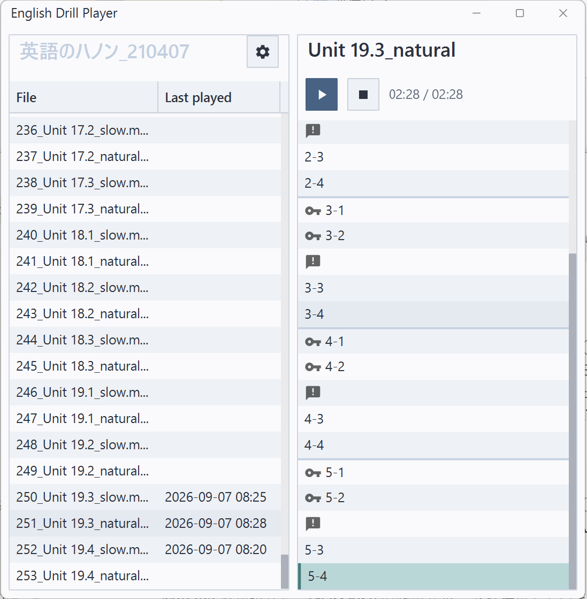

# English Drill Player

This is a practice audio player for "Eigo no Hanon" (English Hanon).

You must purchase "Eigo no Hanon" and download the accompanying audio files.



## Requirements

- Java 25
- Maven

## How to Run

```bash
mvn javafx:run
```

## Development

### JavaFX Preview Features

The main window uses `StageStyle.EXTENDED` and `HeaderBar`, which are preview
features of JavaFX 26. They need the JVM option `-Djavafx.enablePreview=true`.
The option is already set in `pom.xml` for `mvn javafx:run`, `mvn test`, and
the packaged app (jpackage).

### How to Test

```bash
mvn test
```

The tests run in headless mode, so no window is opened.

### Survey of the real drill files

`DrillBookSurveyTest` runs the segment detector and the drill book parser
over every mp3 file in a folder. It runs only when the folder is given:

```bash
mvn test -Dtest=DrillBookSurveyTest "-Dedp.survey.folder=<path to the folder of the drill files>"
```

It fails when a file cannot be split into drills, and prints the sound and
silence lengths of that file. Run it after changing the detection
parameters or the parsing rules (see ADR 003 and ADR 004).

### How to Format

```bash
mvn formatter:format
```

### How to Package

```bash
mvn package
```

This creates a native application image with jpackage under `target/jpackage/`.
